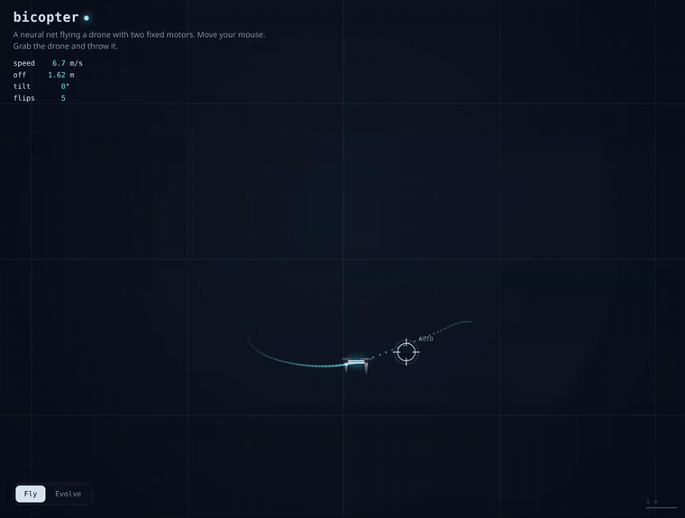
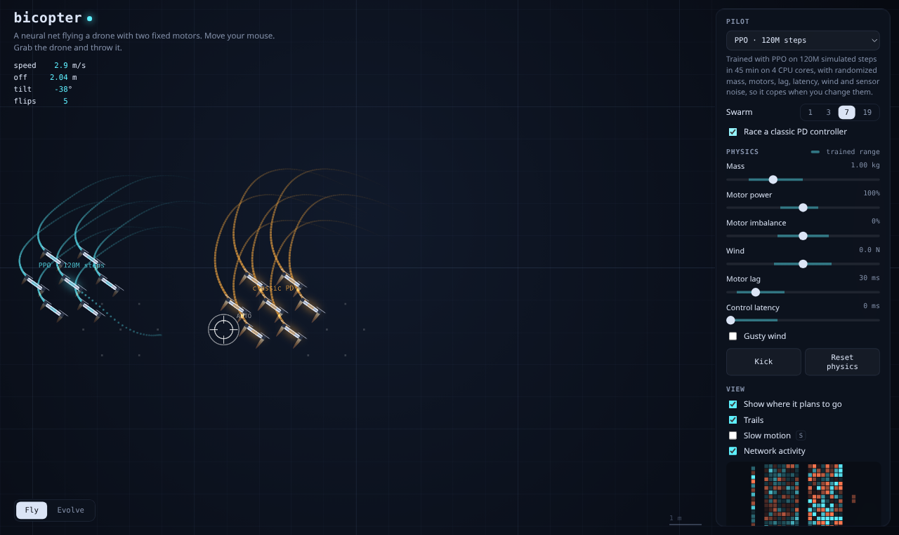
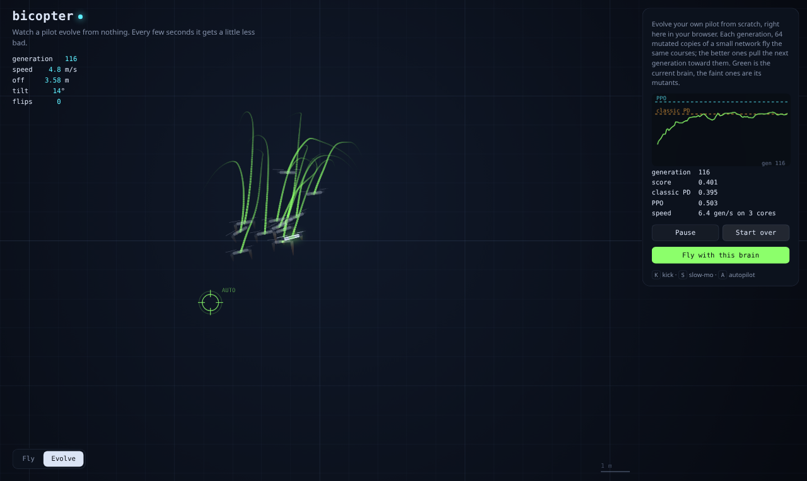
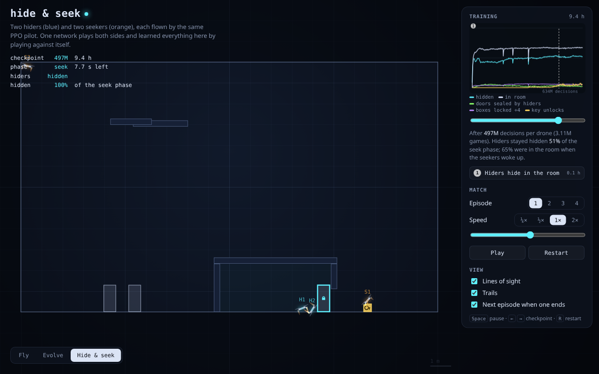
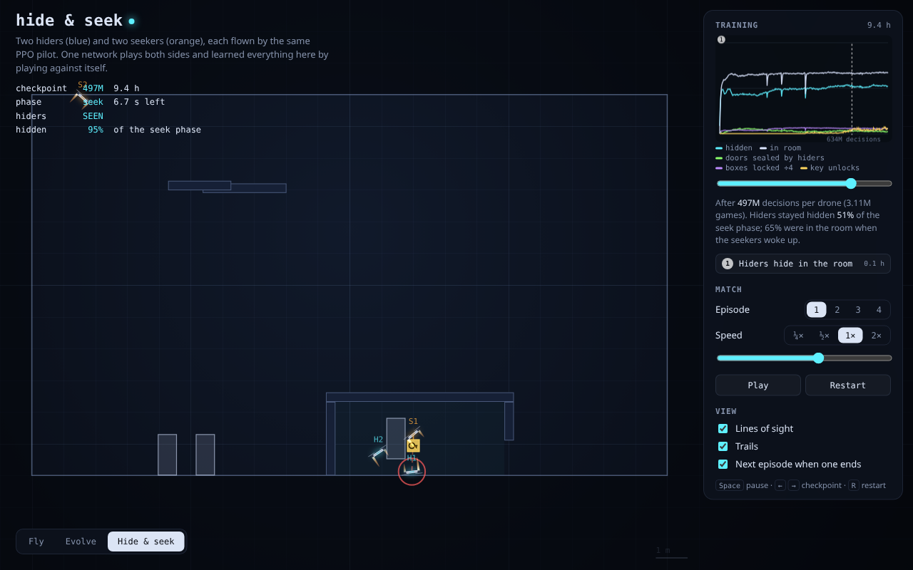

# bicopter

**[Try it live: bicopter.vercel.app](https://bicopter.vercel.app)**

A 2D drone with two fixed, downward-pointing motors, flown by a small neural network. It chases your cursor, flips
upside down to dive faster, shrugs off wind and heavier payloads, and recovers when you grab it and throw it. You can
also evolve your own pilot from scratch in the browser, spread across your CPU cores.



The drone can only push with its two motors, so to move sideways it has to tilt, and to stop it has to tilt the other
way before it overshoots. The network learned all of that, plus a few tricks nobody told it about, by flying about
120 million simulated steps in JAX.

## What you can do in the app

- **Fly.** Move the mouse and the drone follows. Grab it, throw it, kick it (`K`), or let the autopilot (`A`) fly
  jumps, orbits and figure-eights.
- **Break it.** Sliders change mass, motor power, motor imbalance, wind, motor lag and control latency. A shaded band
  on each slider shows the range the network saw in training, so you can push it past that and watch it fail.
- **Race.** Fly a swarm of up to 19 drones, or race the network against a hand-tuned classic PD controller.
- **Look inside.** See where the drone plans to go next, and watch the network's neurons light up as it flies.
- **Evolve.** Start from a random network and evolve one in Web Workers with an evolution strategy, then fly it.
- **Hide and seek.** Watch two hider drones and two seeker drones play hide and seek, at checkpoints spread across a
  12-hour self-play run.





## Results

`bun bench.ts` on the shipped brain (PPO, 120M steps, 45 min on 4 CPU cores) against a hand-tuned cascaded PD
controller:

| | PD | PPO |
| --- | --- | --- |
| Score on 24 jump courses (reward/step) | 0.405 | **0.526** |
| Same, heavy + laggy + weak motor | 0.243 | **0.457** |
| 6-11 m dive, time to settle | 2.58 s | **1.78 s** (flips over to thrust downward) |
| Corner to corner | 3.48 s | **2.49 s** |
| Recover from a spinning throw | 1.88 s | **1.69 s** |
| Distance behind a circling target | 1.09 m | 1.09 m |
| Hold position in 3 N gusty wind | 0.81 m | **0.52 m** |

The in-browser evolution strategy reaches the PD controller's score in about 20 seconds on one core and then hovers
around it; the app spreads it over all but one of your cores. Gradient-based PPO with domain randomization stays well
ahead.

## Hide and seek

**[Watch the replays: bicopter.vercel.app/hideseek.html](https://bicopter.vercel.app/hideseek.html)**

A take on [OpenAI's hide and seek](https://openai.com/index/emergent-tool-use/) with the drones. Two hiders and two
seekers share a level with a room, one or two doorways and four boxes, one of them a key. The hiders get 6 seconds to
prepare while the seekers are frozen, then the seekers have 10 seconds to find them. Hiders score each step no seeker
can see them, and seekers score the opposite. A drone can pick up a box, carry it and drop it, and can lock a box near
it so the other team can't move it. Locks are permanent: only a seeker carrying the key can open a hider lock, by
flying the key up to it.





No behavior is scripted. One network plays both sides and learns by playing against itself and older copies of itself.
Every decision it makes is a high-level command: where to fly, plus grab and lock buttons. The trained pilot from above
turns those commands into motor thrust. Over a 12-hour run (634M decisions per drone, about 4M games) it learned to:

1. **Hide in the room.** Within half an hour, two thirds of hiders are inside when the seekers wake up.
2. **Seal and lock the doorway.** Hiders push a block into the doorway and lock it, so the seekers can't shove it
   aside.
3. **Break into unlocked forts.** Seekers learned to push open any doorway block the hiders left unlocked. Locking
   during prep cut those break-ins from about 0.2 per game to under 0.1.
4. **Use the key.** After about 6 hours, seekers began flying the key to locked doors and opening them. This is still
   rare at the end of the run (about 0.07 unlocks per game), and the hiders' reward was trending back toward even
   when the run stopped.

The game settled near even: hiders stay hidden for about half of the seek phase. Some fixes along the way came from
watching replays:

- **Permanent locks.** When locks could be toggled, the agents spent all game locking and unlocking things.
- **A minimum press rate.** The policy stopped pressing the grab and lock buttons too early to find out what they
  did. Each role now keeps a small floor on how often it presses each button.
- **Practice forts.** Some games start with a fort already sealed or nearly sealed, so hiders can find out that
  finishing it pays off.
- **An easier key.** Some games start with a seeker already holding the key, and the key opens a lock just by coming
  close.

It is trained with PPO in JAX, with an omniscient critic and a pool of past opponents, running on a 64-core
[Upstash Box](https://upstash.com/docs/box) at about 15k decisions per second.

## How it works

```
spec.json ──► train/ (JAX)                         web/ (TypeScript)
              sim.py  physics + observation   ═══  sim/physics.ts   same physics, checked by parity tests
              env.py  targets, randomization       sim/policy.ts    network forward pass, PD controller
              ppo.py  PPO, whole update jitted     evolve/          evolution strategy in Web Workers
              export  brain_*.json  ─────────────► public/brains/   loaded by the app
```

| Path | What |
| --- | --- |
| `spec.json` | Physics constants, observation scaling, domain randomization, reward. Read by both sides. |
| `train/` | JAX environment and PPO trainer (PureJaxRL style: rollout and update are one jitted function). |
| `web/` | Vite + TypeScript app: the same physics, the trained network, an evolution strategy in Web Workers. |

The TypeScript simulator is a line-for-line port of `train/bicopter/sim.py`. `web/tests/parity.test.ts` checks both
the physics and the network forward pass against fixtures generated from JAX, so a brain trained in Python flies the
same in the browser.

### Physics

Rigid body in 2D with gravity, linear and quadratic drag, and two motors at the ends of a 0.2 m arm. Motors only push,
follow their command with first-order lag, and commands can arrive up to two control steps late. The simulator runs at
60 Hz with four semi-implicit Euler substeps.

### What the network sees and controls

Observation (15 numbers): offset to the target (coarse and fine), velocity, target velocity, sin and cos of the angle,
angular velocity, current motor thrusts, and the previous command. Action (2): a thrust command per motor. The policy
is a 15-128-128-2 tanh network, small enough to run for a swarm of drones at 60 Hz on the main thread.

### Training

PPO with 4096 parallel environments, 32-step rollouts, 32 minibatches and 4 epochs per update, and a 256-256 critic.
Each episode randomizes mass, inertia, per-motor thrust, motor lag, latency, wind and gusts, and sensor noise, ramping
the randomization in over the first 15% of training. Targets jump, glide, hold still or fly Lissajous orbits.

The reward pays for being close (with an extra bonus inside 0.3 m), for staying upright and not spinning near the
target, and charges a little for jerky commands. Without the near-target terms the network learned to circle the
target in a loop instead of hovering on it.

## Run it

### Web

```sh
cd web
bun install
bun run dev
bun test                                   # physics and policy parity with JAX
bun bench.ts public/brains/ppo-best.json   # fixed-scenario benchmark vs the classic PD controller
bun run build
```

### Train

```sh
cd train
uv sync
uv run python train.py --steps 120e6 --out runs/main   # the shipped brain; ~45k steps/s on 4 CPU cores
uv run python make_fixtures.py                          # after changing sim.py or the network export
python3 publish.py runs/main                            # copy brains into web/public/brains
```

Checkpoints are written at 1M, 3M, 10M, 30M and 100M steps, plus `brain_best.json`, ranked by a deterministic
evaluation once domain randomization is fully on. All of them show up in the app's pilot menu, so you can watch how the
pilot improved over training.

Hide and seek:

```sh
uv run python test_game.py                                # game rules and physics
uv run python train_game.py --hours 12 --out runs/hs      # self-play; --resume runs/hs/ckpt_*.npz continues a run
python3 publish_game.py runs/hs                           # copy replays and curves into web/public/hideseek
```

## License

MIT
